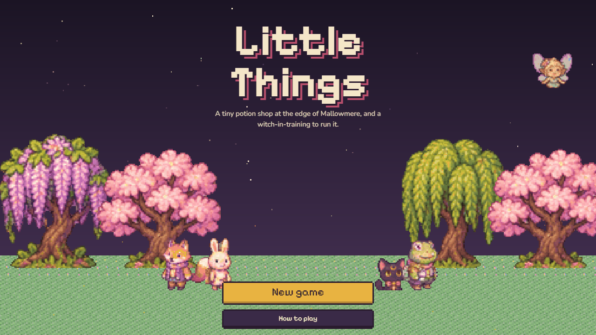
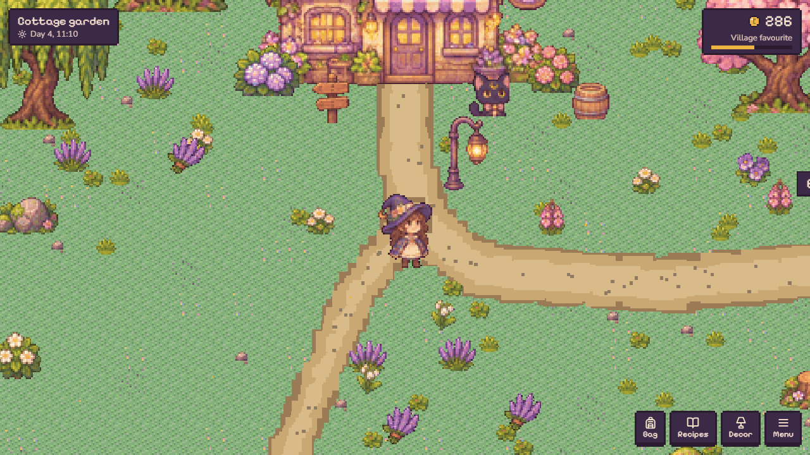
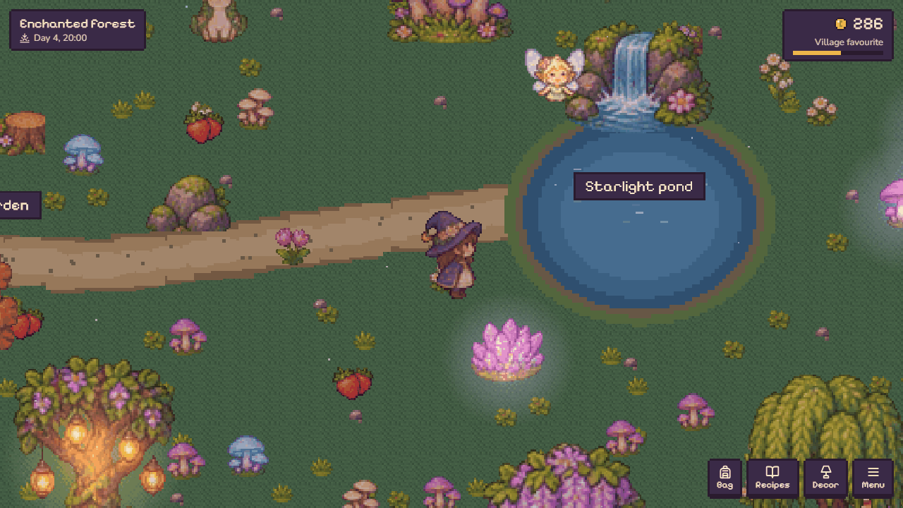
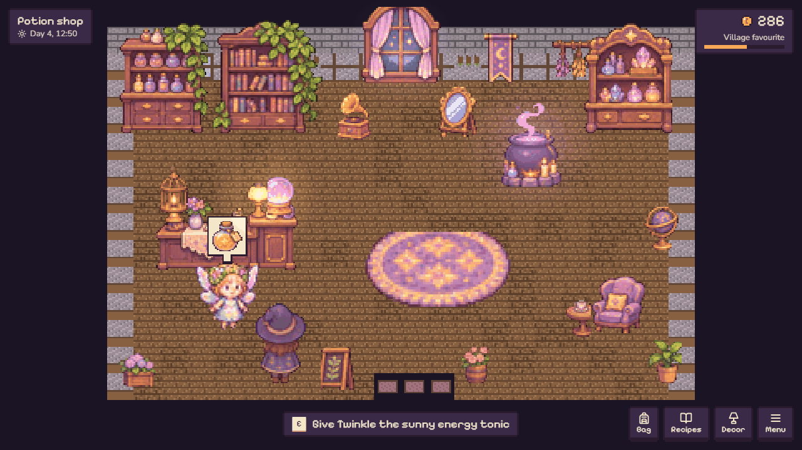
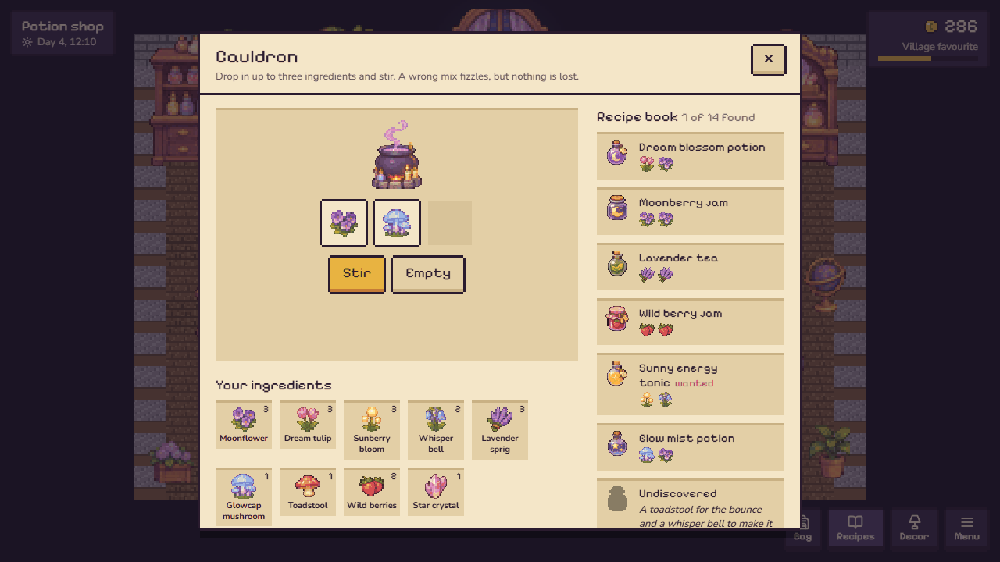
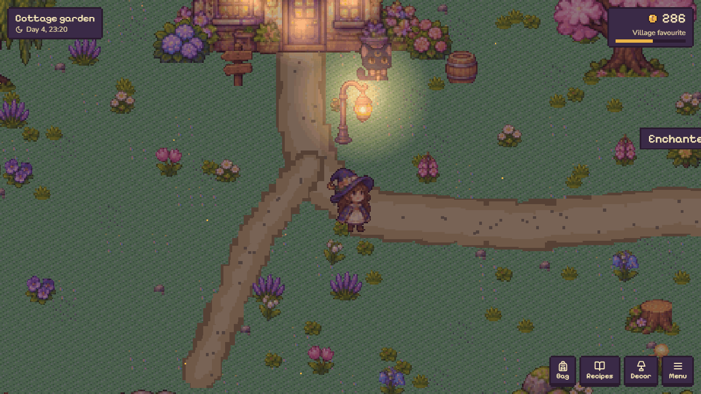
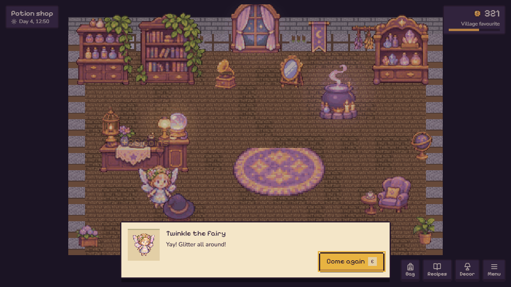
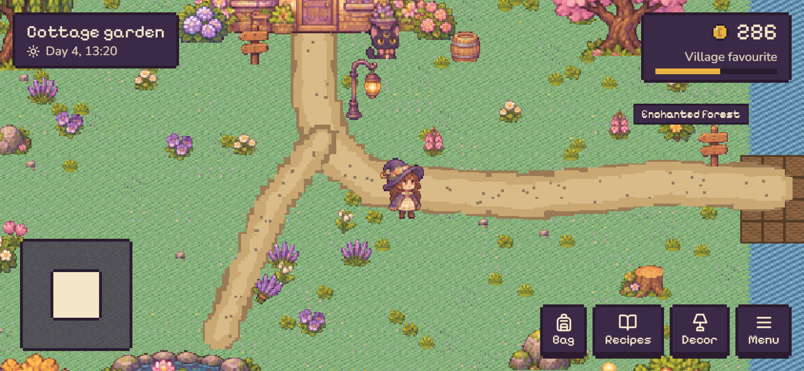

<div align="center">

# Little Things

**A cosy pixel-art potion shop game that runs in your browser.**

Gather flowers, experiment at the cauldron and serve the curious villagers of Mallowmere.

[](https://github.com/murtazabhatia/webg/actions/workflows/ci.yml)




</div>

---

## About

You play **Mimi**, a witch-in-training who has just taken over a tiny potion shop at the edge of the village of Mallowmere. Every day villagers drop by with a wish. Wander the cottage garden and the enchanted forest to pick ingredients, mix them in the cauldron until you discover what they make, and earn enough coins and reputation to turn the shop into something special.

There are no timers to beat and nothing to lose. A wrong mix simply fizzles.

## Screenshots

<table>
  <tr>
    <td width="50%"></td>
    <td width="50%"></td>
  </tr>
  <tr>
    <td align="center"><sub><b>The cottage garden.</b> Ingredients sprout in a new spot every time you pick one.</sub></td>
    <td align="center"><sub><b>The enchanted forest.</b> Glowcaps, toadstools, berries and the odd star crystal.</sub></td>
  </tr>
  <tr>
    <td></td>
    <td></td>
  </tr>
  <tr>
    <td align="center"><sub><b>Customers walk in</b> and show you what they want.</sub></td>
    <td align="center"><sub><b>Brew by experiment.</b> Up to three ingredients, then stir.</sub></td>
  </tr>
  <tr>
    <td></td>
    <td></td>
  </tr>
  <tr>
    <td align="center"><sub><b>Day and night.</b> Lamps, windows and crystals light up after dark.</sub></td>
    <td align="center"><sub><b>Happy customers</b> pay up and spread the word.</sub></td>
  </tr>
</table>

<p align="center">
  <br>
  <sub><b>Made for phones too.</b> Touch joystick, tap-to-act button, and it installs to your home screen.</sub>
</p>

## Features

- **Ingredient brewing.** Combine up to three of 9 ingredients to discover 14 potions. Each discovery is recorded in your recipe book, and undiscovered recipes come with a riddle-style hint.
- **Living customers.** Twelve villagers, from a haggling fox to a ghost who keeps floating through the wall, walk in, wait at the counter and leave happy. As your reputation grows they ask for rarer potions.
- **Never the same field twice.** Ingredients grow in random spots and regrow somewhere new after you pick them.
- **A shop to make your own.** Spend coins on six decorations that appear in the shop the moment you buy them.
- **Day and night.** A shared clock carries on as you travel between places, with warm lights after dark.
- **Phone, tablet and desktop.** Keyboard or touch controls, a layout that adapts to any screen, full-screen mode, and offline play once installed.
- **Your progress is safe.** It saves as you play and when you leave, and damaged saves are repaired instead of lost.

## How to play

1. **Gather.** Walk up to a flower or mushroom and press <kbd>E</kbd> (or tap the action button) to pick it.
2. **Brew.** In the shop, use the cauldron. Add ingredients, press **Stir** and see what happens.
3. **Serve.** Talk to the customer at the counter. If you have what they want, you'll hand it over.
4. **Grow.** Coins buy decorations; serving customers raises your reputation and unlocks fancier requests.

| Keyboard | Touch | Action |
| --- | --- | --- |
| <kbd>W</kbd> <kbd>A</kbd> <kbd>S</kbd> <kbd>D</kbd> or arrow keys | Joystick | Walk |
| <kbd>E</kbd> | Yellow action button | Pick, talk, brew, serve |
| <kbd>I</kbd> | **Bag** | Your ingredients and potions |
| <kbd>B</kbd> | **Recipes** | Recipe book |
| <kbd>M</kbd> | **Decor** | Buy decorations |
| <kbd>Esc</kbd> | **Menu** | Pause, sound, save, full screen |

<details>
<summary><b>All 14 recipes (spoilers)</b></summary>

<br>

| Reputation | Potion | Ingredients |
| :---: | --- | --- |
| 1 | Dream blossom potion | Dream tulip + moonflower |
| 1 | Moonberry jam | 2 moonflowers |
| 1 | Lavender tea | 2 lavender sprigs |
| 1 | Wild berry jam | 2 wild berries |
| 1 | Sunny energy tonic | Sunberry bloom + whisper bell |
| 2 | Glow mist potion | Glowcap + moonflower |
| 2 | Toadstool tonic | Toadstool + whisper bell |
| 2 | Cloud in a jar | 2 whisper bells + lavender sprig |
| 3 | Love potion | 2 dream tulips + sunberry bloom |
| 3 | Starlight elixir | Sunberry bloom + dream tulip + glowcap |
| 3 | Ember jar | Toadstool + sunberry bloom + wild berries |
| 4 | Frost jar | Star crystal + whisper bell |
| 4 | Rainbow elixir | Star crystal + lavender sprig + sunberry bloom |
| 5 | Fairy dust | Star crystal + glowcap + dream tulip |

Garden: moonflower, sunberry bloom, dream tulip, whisper bell, lavender.
Forest: glowcap, toadstool, wild berries, star crystal (rare), plus some garden flowers.

</details>

## Getting started

Requires **Node.js 20.19 or later** (22 LTS recommended).

```bash
git clone https://github.com/murtazabhatia/webg.git
cd webg
npm install
npm run dev
```

Then open <http://localhost:3000>.

| Command | What it does |
| --- | --- |
| `npm run dev` | Development server with hot reload |
| `npm run build` | Production build into `out/`, a fully static site of about 3.6 MB |
| `npm start` | Serve the built `out/` folder on port 3000 |
| `npm test` | Unit tests with Vitest |
| `npm run lint` | ESLint |
| `npm run typecheck` | TypeScript in strict mode |
| `npm run check` | Type-check, lint and test in one go |

## Deployment

The build is plain static files with no server code, so it runs on any static host or CDN.

| Host | How |
| --- | --- |
| **GitHub Pages** | `.github/workflows/deploy-pages.yml` publishes every push to `main`. Turn it on once in **Settings → Pages → Source: GitHub Actions**. The site will then be at `https://murtazabhatia.github.io/webg/`. |
| **Vercel** | Import the repository. `vercel.json` adds caching and security headers. |
| **Netlify / Cloudflare Pages** | Build command `npm run build`, output directory `out`. Headers come from `public/_headers`. |
| **Docker** | `docker build -t little-things .` then `docker run -p 8080:8080 little-things` (nginx, see `deploy/nginx.conf`). |

| Environment variable | Purpose |
| --- | --- |
| `NEXT_PUBLIC_BASE_PATH` | Set when serving from a sub-path, for example `/webg`. GitHub Pages sets it automatically. |
| `NEXT_PUBLIC_SITE_URL` | The full site URL, used for link previews on social media. |

Every pull request runs type-checking, lint, the test suite and a production build in CI. CI fails if the built site grows past 10 MB.

## How it's built

| Layer | Technology |
| --- | --- |
| Page and build | Next.js 15 (static export), React 19 |
| Game world | Phaser 3 for scenes, movement, collisions, lighting and animation |
| Interface | React components drawn over the canvas, styled with Tailwind CSS |
| State | Zustand store shared by the interface and the game |
| Game rules | Plain TypeScript classes in `src/domain/`, fully unit tested |
| Audio | Music and sound effects synthesised live with the Web Audio API, with no audio files |
| Offline | A service worker caches the game so it can be installed and played offline |

```
src/
├─ app/            page, layout, design tokens, manifest
├─ components/     HUD, panels, cauldron, title screen, touch controls
├─ domain/         inventory, brewing, customers, economy, reputation
├─ game/
│  ├─ scenes/      Boot, Title, CottageGarden, PotionShop, EnchantedForest
│  ├─ systems/     shared day/night clock, random foraging
│  └─ data/        items, recipes, sprite manifest
├─ hooks/          keyboard, autosave, touch detection, service worker
├─ lib/            saving, settings, audio, device helpers
└─ store/          shared game state
scripts/           Python tools that cut sprites from the source art
assets/            source art sheets (not shipped)
public/assets/     the sprites the game loads
```

### Design system

The interface is styled like the labels and signs in Mimi's apothecary: parchment panels with notched pixel frames, chunky buttons that press down, and no blur or rounded corners. Colours are defined once as tokens in `src/app/globals.css` (night, plum, ink, paper, honey, moss, rose). **Pixelify Sans** is used for names, titles and numbers, and **Nunito** for anything you read as a sentence. Keyboard focus is always visible, dialogs keep focus inside them, and animations respect the reduced-motion setting.

### Saves

Saves are versioned and validated when loaded (`src/lib/SaveManager.ts`). Saves from the original prototype are upgraded automatically, and a damaged save is repaired field by field instead of crashing the game.

### Testing

`npm test` runs 49 unit tests covering the inventory, brewing, customers, reputation, the save format, the clock and random placement. One suite checks the recipes themselves: every hint names exactly the ingredients its recipe needs, every ingredient grows somewhere, and no two recipes share a mix.

### Art pipeline

The original sprite sheets live in `assets/`. Two scripts cut the game's sprites out of them from hand-checked regions (Python 3 with Pillow, NumPy and SciPy):

```bash
python scripts/extract_characters.py --preview preview.png   # villagers, Pickles, Pip, the willow deer
python scripts/extract_environment.py --boxes boxes/          # draw the regions to check them
python scripts/extract_environment.py                         # scenery, furniture, ingredients, potions
```

After adding or renaming sprites, update `src/game/data/sprites.ts` to match.

## Contributing

1. Create a branch from `main`.
2. Run `npm run check` before opening a pull request. CI runs the same checks plus a production build.
3. Keep game rules in `src/domain/` with tests, and keep Phaser code in `src/game/`.

## Credits

Game design, characters and art by the Little Things team. Based on the original [Little Things prototype](https://github.com/InsiyahBhatia/little-things).
